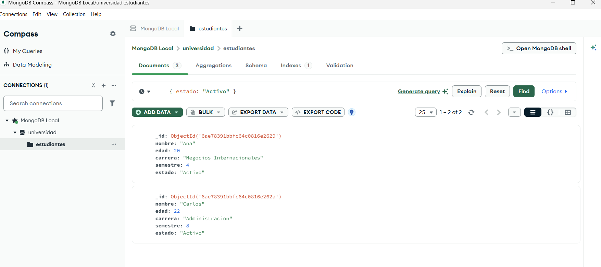

# Student Management Database — MongoDB

## 📌 Project Overview

This project demonstrates basic database management operations using MongoDB.

The objective is to create a student database, import JSON data, and perform queries using comparison operators.

This project is part of my learning journey toward Data Engineering.

## 🛠️ Technologies Used

- MongoDB Community Server
- MongoDB Compass
- MongoDB Query Language (MQL)
- JSON
- GitHub

## 📂 Project Structure

```text
mongodb-student-management/
├── data/
│   └── estudiantes.json
├── queries/
│   └── consultas.js
└── README.md
```

## 🗄️ Database Information

**Database:** `universidad`

**Collection:** `estudiantes`

The dataset contains three fictional students with the following fields:

- `nombre`: Student name
- `edad`: Student age
- `carrera`: Academic program
- `semestre`: Current semester
- `estado`: Student status

## 🔎 Implemented Queries

**1. Find active students**

```javascript
db.estudiantes.find({ estado: "Activo" })
```

Expected result: Ana and Carlos.

**2. Find students above semester 5**

```javascript
db.estudiantes.find({
  semestre: { $gt: 5 }
})
```

Expected result: Carlos and Pedro.

**3. Find students aged 21 or older**

```javascript
db.estudiantes.find({
  edad: { $gte: 21 }
})
```

Expected result: Carlos and Pedro.

**4. Find students whose status is not Active**

```javascript
db.estudiantes.find({
  estado: { $ne: "Activo" }
})
```

Expected result: Pedro.

## ▶️ How to Run

1. Install MongoDB Community Server and MongoDB Compass.
2. Connect to the local MongoDB server using `mongodb://localhost:27017`.
3. Create a database named `universidad`.
4. Create a collection named `estudiantes`.
5. Import `data/estudiantes.json` into the collection.
6. Open the collection in MongoDB Compass.
7. Execute the filters from `queries/consultas.js` using the Compass filter bar. Enter only the filter object, without `db.estudiantes.find()`.

## ✅ Results

- Successfully imported 3 student documents.
- Tested 4 database queries in MongoDB Compass.
- Applied `$gt`, `$gte`, and `$ne` comparison operators.
- Verified the expected query results.

## 📚 What I Learned

Through this project, I practiced MongoDB document structures, JSON data import, collection management, and query filtering.

## 🚀 Future Improvements

- Implement insert, update, and delete operations.
- Add data validation.
- Create database indexes.
- Document additional queries and tests.


## 📸 Query Execution Evidence

### Active Students Query

The following screenshot shows the successful execution
of a MongoDB query filtering active students.



